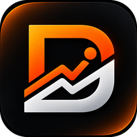

# Driv

**Ditt mål. Ditt driv.** Träning, dailys och kost i en app, med plus eller minus mot förra veckan så att du ser att du blir bättre. Inga beroenden och inget konto krävs: allt sparas i din webbläsare, och med ett gratis konto även tryggt i molnet.

**Öppna appen:** https://driv.driveify.se/

På mobilen kan du lägga den på hemskärmen: *Dela → Lägg till på hemskärmen* i Safari, eller *Installera app* i Chrome. Den fungerar sedan även utan nät.

## Funktioner

- **Upplägg:** elva program att söka bland, bland annat Push/Pull/Legs, Helkropp, Över/Underkropp, Calisthenics, Styrka 5×5, Styrkelyft, Arnold split, Hemma med hantlar och Rumpa & ben. Välj 1–7 pass i veckan, i ordning valfria dagar eller på fasta veckodagar.
- **Övningar:** drygt 45 övningar, var och en med en illustration och tips (animerad när du öppnar övningen). Förifyllt per upplägg, sökbart och utbytbart, med egna set och reps.
- **Under passet:** Träna visar passet med en rad per övning (mål och set klara); ett tryck öppnar fokusläget på den övningen. Fokusläget har en övning i taget, stora − och +-knappar för vikt och reps, förra gångens resultat på varje set och skärmen tänd så länge passet pågår. Bocka av ett set så startar vilotimern, och när övningen är klar visas nästa. Kroppsviktsövningar loggas i reps eller sekunder med valfri extra vikt. Flera pass samma dag går bra.
- **Slå förra veckan:** dagens mål på varje övning, besked när du slår pers, hur många övningar som gått upp den här veckan och en graf per övning.
- **Historik:** en kalender med alla pass och dagar då alla dailys gjorts. Tryck på en dag för att ändra den: bocka dailys och väg dig i efterhand, eller öppna Träna eller Kost för den dagen och logga ett pass eller mat du glömt. Under kalendern jämförs veckan med veckan innan: bästa set per övning med + eller −, samt pass, dailys, löpning, kalorier och veckobrevet.
- **Dailys:** egna övningar, löpning eller promenad att bocka av direkt på Idag, med streaks och påminnelse i kalendern.
- **Fyra flikar:** Idag, Träna (med kommande pass), Kost och Historik. Profil och inställningar nås via kugghjulet.
- **Kost:** kalorimål och makron från ålder, längd, vikt, aktivitet och mål. Skriv vad du åt i fritext, till exempel "2 dl mjölk och 1 banan", så räknas kalorier och protein ut från drygt 2 800 livsmedel och rätter. Medan du skriver föreslår appen träffar, och felstavningar som "kottbullar" hittar rätt. Sidan visar en ruta per måltid (frukost, lunch, mellanmål, middag); *+ Lägg till* öppnar sök och snabbval för just den måltiden. Mängden styr: varje livsmedel får antal, gram, dl eller portioner som går att ändra, och kalorier och protein räknas fram. Favoriter, egna måltider och det du ätit nyligen ligger som snabbval, och samma snabbval två gånger blir två stycken. En måltid kan upprepas från förra gången med ett tryck, och flera saker kan sparas som en måltid. Logga även en måltid med ungefärliga kalorier eller skanna streckkoden på en vara.

## Data och integritet

Utan konto sparas allt bara i webbläsaren på den enhet du använder. Under *Profil → Data* kan du exportera en säkerhetskopia och importera den på en annan enhet.

Med konto (*Profil → Konto*, inloggning med e-post utan lösenord) sparas inställningar och logg även i en Supabase-databas, så att inget försvinner och samma data finns på alla dina enheter. Varje användare kan bara läsa och ändra sina egna rader.

Streckkodsskannern hämtar produktdata från [Open Food Facts](https://world.openfoodfacts.org) (ODbL). Kameran används bara medan skannern är öppen.

Kalorivärden och kalorimål är uppskattningar och ersätter inte råd från vården.

Näringsvärden kommer delvis från [Livsmedelsverkets livsmedelsdatabas](https://www.livsmedelsverket.se/livsmedelsdatabasen), licens CC BY 4.0.

## Filer

| Fil | Innehåll |
|---|---|
| `index.html` | Sidan och stilarna |
| `app.js` | Appen: upplägg, pass, dailys, kost, veckovy och lagring |
| `ovningar.js` | Övningsbiblioteket med instruktioner och poser |
| `figur.js` | Ritar de animerade övningsbilderna som SVG |
| `mat.js` | Egna livsmedel med portionsstorlekar, tolkning av fritext, förslag och felstavning |
| `livsmedel.js` | Livsmedelsverkets livsmedelsdatabas (namn, kcal och protein per 100 g) |
| `config.js` | Supabase-projektets adress och publika nyckel |
| `supabase/schema.sql` | Tabell och åtkomstregler i Supabase |
| `manifest.webmanifest`, `sw.js`, `icons/` | Installation på hemskärmen och offlinestöd |

## Slå på konton (Supabase)

1. Skapa ett gratis projekt på [supabase.com](https://supabase.com).
2. Öppna *SQL Editor*, klistra in innehållet i [`supabase/schema.sql`](supabase/schema.sql) och kör det.
3. Under *Authentication → URL Configuration*: sätt *Site URL* till appens adress, till exempel `https://driv.driveify.se/`, och lägg till samma adress under *Redirect URLs*.
4. Under *Authentication → Email Templates → Magic Link*: lägg till `{{ .Token }}` i mejlet, så får användaren en kod att skriva in i appen. Det behövs i en installerad app på iPhone, där länken öppnas i webbläsaren i stället för i appen.
5. Fyll i *Project URL* och *anon public key* (under *Project Settings → API*) i [`config.js`](config.js).

## Tester

Webbläsartesterna i [`tests/`](tests) går igenom upplägg, pass och veckojämförelse, dagens mål, vilotimer, dailys, vikt, påminnelser, kost, streckkod, lagring, synk mellan enheter och start utan nät. Externa tjänster (Supabase, Open Food Facts) simuleras. De körs automatiskt i GitHub vid varje push, och lokalt med:

```bash
pip install -r tests/requirements.txt
python -m playwright install chromium
python -m pytest tests
```

## Ny version

Appen startar från filer som service workern (`sw.js`) har sparat. När filerna ändras måste versionen i `sw.js` uppdateras, annars får användarna inte den nya versionen. Kör:

```bash
python tools/sw-version.py
```

Testerna larmar om versionen inte stämmer med filerna.

## Design

Färgerna ligger som variabler överst i `index.html`, för ljust och mörkt läge. Text och knappar har egna, mörkare toner (`--accent-strong`, `--accent-text`, `--ok-text`, `--bad-text`, `--on-color`) så att kontrasten når WCAG AA (4,5:1); `--accent` och `--ok` används för staplar, prickar och ramar. `tests/test_design.py` går igenom all synlig text i varje vy och fönster i båda lägena och kontrollerar kontrasten, och att inget sticker ut utanför skärmen i 320 och 390 px bredd.

## Publicera

Appen är statiska filer. Med GitHub Pages: *Settings → Pages → Build and deployment → Deploy from a branch → `main` / `(root)`*.
